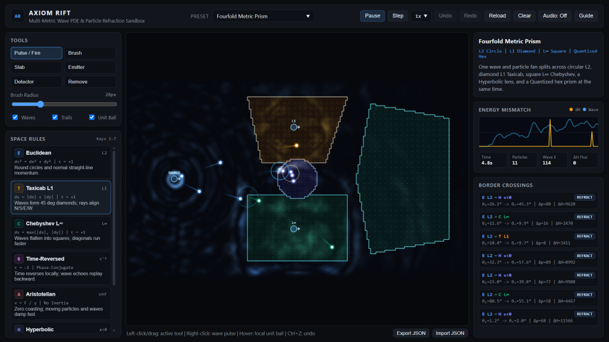

# AXIOM RIFT

A 2D wave and particle sandbox where different painted areas follow incompatible rules for distance, inertia, and time direction.

Live demo: https://vaavgit.github.io/axiom-rift/



Instead of painting physical materials like glass or water, you paint different spatial rules onto a `192 x 112` grid. Wave fronts shift shapes per zone (circular in Euclidean space, 45 deg diamonds in Taxicab, axis-aligned squares in Chebyshev, 6-fold hex modulation in Quantized), while particles obey generalized Snell refraction and total internal reflection across borders. Crossing borders between rules sparks visual rings, logs real energy mismatch (`dH`) and momentum recoil (`dp`), and triggers optional WebAudio chimes.

## Running locally

Requires Node.js 20 or newer, with no external npm packages to install.

```bash
npm start
```

Open `http://127.0.0.1:4173`. To run the engine and server tests:

```bash
npm test
```

Because `index.html`, `styles.css`, and `src/` use relative module paths, the app also runs directly as a static site on GitHub Pages without Node in production.

## Space rules

| Rule | Wave behavior | Particle behavior |
| :--- | :--- | :--- |
| Euclidean (`E`) | Isotropic 9-point Laplacian (circular fronts). | Straight-line inertial motion (`L2` norm). |
| Taxicab (`T`) | Directional curvature operator (`L1` diamond fronts, ~0.71 diag/axis). | Gently aligns trajectories toward cardinal axes (`L1` norm). |
| Chebyshev (`C`) | Directional curvature operator (`L∞` square fronts, ~1.41 diag/axis). | Gently aligns trajectories toward 45 deg diagonals (`L∞` norm). |
| Time-Reversed (`R`) | Passive capture/replay boundary half-cycles at borders. | Negative damping up to a speed cap; phase clock runs backward. |
| Aristotelian (`A`) | Overdamped diffusion; waves damp out quickly. | Strong viscous drag; drops kinetic energy on entry. |
| Hyperbolic (`H`) | Speed scales with local interior depth of the painted region. | Bends along local conformal depth gradients; causes steep-angle TIR. |
| Quantized (`Q`) | 6-fold angular speed modulation. | Snaps speed to discrete shells (`55, 100, 145, 190`) and 60 deg rays. |

## Built-in presets

- **Fourfold Metric Prism**: splits one emitter fan across Euclidean, Taxicab, Chebyshev, Hyperbolic, and Quantized zones.
- **L1 / L2 Angle Diode**: demonstrates transmission vs 45 deg bounce reflection with zero solid walls.
- **Border Oscillator**: particles lose energy in an Aristotelian strip and regain it in a Time-Reversed wing inside a Hyperbolic cavity.
- **Particle Half-Adder**: 1-bit billiard-ball logic demo (`SUM = A XOR B`, `CARRY = A AND B`) using colliding beams and 45 deg Hyperbolic bounce seams.
- **Time-Reversal Echo Cavern**: waves scatter around obstacles and reflect back from a Time-Reversed boundary half-cycle.
- **Echo Mandala**: nested concentric rings wired as a generative WebAudio chime loop.

## Controls

- Hover anywhere on the canvas to see the local unit ball shape around the cursor.
- Left-click or drag uses the selected tool (`Pulse / Fire`, `Brush`, `Slab`, `Emitter`, `Detector`, `Remove`).
- Right-click anywhere drops an immediate wave ripple.
- Shortcuts: `Space` (play/pause), `1-7` (pick rule and switch to Brush), `Ctrl+Z` / `Ctrl+Y` (undo/redo paint).

## Architecture and known limits

- **Wave and particle layers are one-way coupled**: particles inject wave pulses on strong collisions and boundary crossings, and both share Snell/metric direction rules, but particles do not read radiation pressure back from the wave array. Waves simply switch PDE operators per cell rather than enforcing particle-style Snell jumps.
- **Time-Reversed mode is an approximation**: rather than solving an ill-posed backward-in-time PDE across the interior, `CHRONO` boundaries passively capture incoming boundary amplitudes for 28 ticks and re-emit them in reverse over the next 28 ticks using convex damping so energy never runs away.
- **Half-Adder timing**: calibrated for `140 px/s` beams (tested across `+/-10%` emitter speed) rather than arbitrary spatial placement.
- **Grid resolution**: the 5-pixel grid turns angled borders into tiny staircase steps, so small 1-cell islands scatter waves noisily.

## Project layout

- `index.html`, `styles.css`: static frontend root for GitHub Pages and local serving
- `server.mjs`: local Node static server with path containment and CSP headers
- `src/engine/`: pure ES modules (`laws.js`, `manifold.js`, `wavefield.js`, `particles.js`, `simulation.js`, `chambers.js`) shared by Node tests and the browser
- `src/audio/synth.js`: procedural WebAudio voice synthesis per destination rule
- `src/ui/`: canvas renderer, oscilloscope/crossing feed, and UI controller
- `tests/engine.test.mjs`: quantitative checks for Snell's law, wave aspect ratios, passive decay, local Hyperbolic invariance, Half-Adder truth table, JSON validation, and HTTP security headers

## License

MIT. See [LICENSE](LICENSE).
